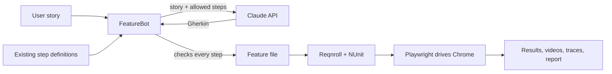

# School ERP – AI-Powered BDD Test Automation

**Author:** Lisna Thomas, QA Engineer · [GitHub](https://github.com/lisnathomas)

End-to-end Playwright tests for [School ERP](https://github.com/coderaticebear/school_erp), a Laravel school management web app with four roles (admin, teacher, student, parent). An AI bot turns user stories into runnable BDD feature files.

The School ERP application was built by Richu Thankachan - (https://github.com/coderaticebear/school_erp/). This repository contains the test automation and the AI bot, which I built.

**Stack:** C# / .NET 8 · Playwright for .NET · Reqnroll (successor to SpecFlow) · NUnit · Claude API

> Uses the app's seeded demo accounts only. Never run these tests against a system with real student or parent data.

---

## What's covered

| Story | Scenarios |
| --- | --- |
| US-001 Log in to School ERP | Each of the four roles lands on its own dashboard; wrong password, unknown email and empty form are rejected with the right messages |

---

## How it works

1. **The story** is written the way a BA would write it, with acceptance criteria and a `Tags:` line.
2. **FeatureBot** reads the story and every `[Given]`/`[When]`/`[Then]` phrase in `StepDefinitions`, and asks Claude to write a feature file using **only** those phrases.
3. **The bot checks the result**, including each step's keyword. If a step has no code yet, it lists it and stops.
4. **Reqnroll** turns the feature file into NUnit tests and **Playwright** runs them in Chrome.
5. **Every scenario is recorded**: a captioned video, a step-by-step trace, and one HTML report per run.

---

## Setup

### 1. Run School ERP

School ERP and OpenMRS both use port 80, so **stop OpenMRS first** (in Docker Desktop, or `docker compose -f docker-compose.yml down` in its folder).

Then start School ERP. If it's already set up, click ▶ next to **school_erp** in Docker Desktop's Containers list. Otherwise, follow the School ERP README (Laravel Sail) and run `./vendor/bin/sail artisan migrate --seed` so the demo accounts exist.

Check http://localhost/login opens, and log in as `admin@example.com` / `password`.

### 2. Run the tests in Visual Studio

1. Open `SchoolErp.AiTests.sln` and choose **Build > Build Solution**.
2. Open **Test > Test Explorer** and click **Run All**. The first run downloads Chrome.
3. You should see **7 tests pass**: four role logins and three error cases.

**How the tests run** is controlled by `SchoolErp.Tests/testsettings.json`:

| Setting | Demo value | Meaning |
| --- | --- | --- |
| `headed` | `true` | Show Chrome while the tests run. Set `false` for fast, invisible runs. |
| `slowMoMs` | `600` | Pause after every browser action so people can follow along. `0` = full speed. |
| `pauseAtEndMs` | `2000` | Keep the final screen (with the PASSED/FAILED banner) visible at the end of each video. |
| `stepCaptions` | `true` | Show the current Gherkin step as a caption at the bottom of the page and video. |
| `recordTrace` | `true` | Save a Playwright trace for step-by-step replay. |
| `baseUrl`, `demoPassword` | | Where School ERP runs and the seeded demo password. |

### Evidence from every run

Each run gets its own folder: `SchoolErp.Tests\bin\Debug\net8.0\artifacts\run-<date-time>\`

| What | For |
| --- | --- |
| **report.html** | One page with every scenario: PASSED/FAILED, duration, video and trace |
| `videos\` | Captioned videos with every checked element outlined and a PASSED/FAILED banner at the end |
| `traces\` | Step-by-step replay: drop a `.zip` into [trace.playwright.dev](https://trace.playwright.dev) (runs in your browser, nothing is uploaded) |
| `screenshots\` | Full-page screenshot when a scenario fails |

### 3. Run the AI bot

1. Save your Claude API key once (PowerShell), then restart Visual Studio: `setx ANTHROPIC_API_KEY "your-key-here"`
2. Right-click **FeatureBot** > **Set as Startup Project**, then press **F5**. It processes every story in `stories/`.
3. To pick one story or run the tests afterwards, set **Command line arguments** (Properties > Debug > Open debug launch profiles UI), e.g. `stories/US-001-login.md --run`.

Settings are in `featurebot.json`; the same bot runs the OpenMRS project too.

---

## Tips

- **Login lockout:** Laravel locks an email for a minute after 5 failed logins. If the wrong-password scenario fails with "Too many login attempts", wait a minute.
- **Review AI output:** the bot guarantees the steps exist, not that the scenarios match the story perfectly.

---